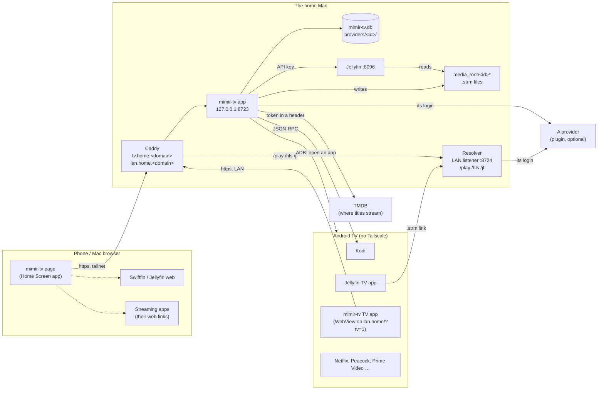
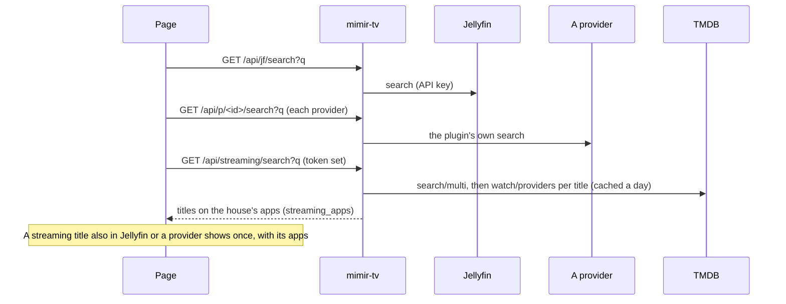
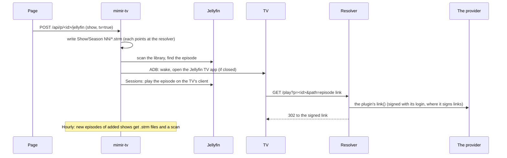

# mimir-tv architecture

mimir-tv is an explorer: it finds a title across your sources and hands playing to the app that should play it.
Jellyfin plays your own videos and anything added from a provider; a streaming title opens in its app.
GitHub draws the diagrams below (Mermaid). When the architecture changes, update this file in the same commit.

## What runs where



- The phone reaches the Mac over Tailscale; the TV has no Tailscale, so `lan.home` resolves to the Mac's LAN address
  and serves both the TV app's page and the resolver.
- Providers are optional. A plugin provider (catalog.py) is in Settings' `providers` with a kind an installed plugin
  registers; without the plugin it is left out (`GET /api/connectors` lists the ones the page shows). Without a TMDB
  token, search leaves out the streaming apps.
- Secrets stay on the Mac: providers' logins and Kodi's password in the vault (mimir-tv.db, encrypted, the key in
  the Keychain); the Jellyfin API key, TMDB token and ADB key in owner-only files. The browser never talks to
  Jellyfin or a provider directly.

## Main paths

### Search



### Add a provider's show to Jellyfin and play it on the TV



### Live TV

A provider's live channel may be a plain-http HLS stream, which https pages refuse (the plugin says so: relayed()).
The resolver's `/hls` relays the playlist, rewriting every variant, segment and key to come back through it, and
only for stream servers a provider handed out (not an open proxy). A link that expires is replaced from its list:
the .strm line carries the list (`page=`) and the plugin's link() finds the fresh one there.

### A title on a streaming app

```mermaid
sequenceDiagram
  participant P as Page
  participant A as mimir-tv
  participant TV as TV
  alt phone
    P->>P: the app's web link (the app opens)
  else TV, or 📺 from the phone
    P->>A: POST /api/streaming/open {app, title}
    A->>TV: ADB: wake; am start SEARCH in the app's package (title shell-quoted), else open the app
  end
```

### Jobs

Each run is recorded with jobkit in `mimir-tv.db` (tables `jobkit_jobs`, `jobkit_runs`); `/jobs` shows them,
with Pause and Run now. A job that fails twice in a row sends one notice (jobkit's notify-url: `openclaw:<phone>`
pushes the title to the OpenClaw iPhone app; any other URL gets an ntfy-style POST).

| Job | Schedule | Does |
|---|---|---|
| `backup` | nightly 3:30 (when `backup_dir` is set) | mimir-tv's and Jellyfin's settings, lists and watch history; no keys or passwords |
| `new-episodes` | hourly | New episodes of added shows into Jellyfin |
| `<id>-<job>` | the plugin's (checked hourly) | A provider's own jobs (catalog.Job), e.g. an index for search |

## Code map (`service/mimir_tv/`)

| Module | Owns |
|---|---|
| [app.py](../service/mimir_tv/app.py) | Startup (`main`): settings, connectors, routers, schedules; the Library page API; `/`, `/api/version`, `/api/connectors` |
| [settings.py](../service/mimir_tv/settings.py) | `settings.json` defaults, environment overrides |
| [wizard.py](../service/mimir_tv/wizard.py), [setup.py](../service/mimir_tv/setup.py), [checks.py](../service/mimir_tv/checks.py) | The Setup steps and the Settings page (one save path), Jellyfin's first run and key, live ✓/✗ checks |
| [jellyfin.py](../service/mimir_tv/jellyfin.py) | Jellyfin's API (libraries, folders, scans, search, sessions) |
| [jf_routes.py](../service/mimir_tv/jf_routes.py) | Your videos: browse, search, and the `/jf/...` proxy that adds the API key |
| [catalog.py](../service/mimir_tv/catalog.py) | The provider plugin interface (Catalog, Job), finding installed plugins, the providers in Settings and their catalogues |
| [catalog_routes.py](../service/mimir_tv/catalog_routes.py) | A provider's pages (`/api/p/<id>/…`): home rows, browse, search, live, play, add to Jellyfin; thumbnails and the relay |
| [providers.py](../service/mimir_tv/providers.py) | Settings' providers: IPTV (M3U, Xtream) through Jellyfin's Live TV, and adding a plugin provider |
| [strm.py](../service/mimir_tv/strm.py) | `.strm` files for shows, movies and live channels; new episodes |
| [resolver.py](../service/mimir_tv/resolver.py), [hls.py](../service/mimir_tv/hls.py) | The LAN listener players fetch from; the HLS relay |
| [mylist.py](../service/mimir_tv/mylist.py) | When each Jellyfin favourite went on My list (newest first) |
| [streaming.py](../service/mimir_tv/streaming.py) | Where titles stream (TMDB), the app catalogue and filter, open on the TV |
| [tv.py](../service/mimir_tv/tv.py), [kodi.py](../service/mimir_tv/kodi.py) | The TV over ADB (open Jellyfin or an app, what is on screen); Kodi's JSON-RPC |
| [recs.py](../service/mimir_tv/recs.py) | Recommendations (E2): each category is a TMDB discover query; the person's filters (apps, language, genre, kind, rating, years) go to TMDB; watched titles left out; a one-line why from the data |
| [prereqs.py](../service/mimir_tv/prereqs.py) | The Setup page (`/setup`): what this Mac needs (Homebrew, uv, Jellyfin, Tailscale), checked; installs one part only on a confirmed request from the Mac itself |
| [mcp_server.py](../service/mimir_tv/mcp_server.py) | `POST /mcp` for an assistant (OpenClaw): tools that call the app's own routes in-process; bearer token, tailnet only |
| [jobs.py](../service/mimir_tv/jobs.py) | The scheduled jobs and the jobs page routes |
| [static/index.html](../service/mimir_tv/static/index.html) | The whole page: phone, Mac and TV mode (`?tv=1`, remote navigation) |
| [android/](../android/) | The TV app: a WebView on mimir-tv's `?tv=1`, the address typed on first launch; mimir-tv serves its APK at `/tv/app.apk` |
